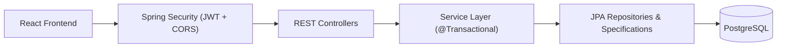

# SmartStock — Inventory & Order Management System

SmartStock is a full-stack inventory and order management application built with Java 21, Spring Boot, PostgreSQL, and React. It demonstrates transactional order processing, concurrency-safe stock validation with pessimistic database locking, stateless JWT role-based security, and server-side search, filtering, and pagination behind a responsive enterprise UI.


## Live Demo

- **Frontend:** https://smartstock-v1.vercel.app/
- **Backend:** https://smartstock-backend-aego.onrender.com

> **Note:** The backend is hosted on Render and may experience a 30–60 second cold start after periods of inactivity.

## Technology Stack

| Layer | Technologies |
|---|---|
| **Backend** | Java 21, Spring Boot, Spring Security, Spring Data JPA, Hibernate |
| **Frontend** | React, Vite, Tailwind CSS, Axios |
| **Database** | PostgreSQL |
| **Authentication** | JWT, BCrypt |
| **Testing** | JUnit 5, Mockito |
| **Deployment** | Docker, Render, Vercel, Neon |
| **Version Control** | Git, GitHub |

## Key Features

**ADMIN**
- Real-time dashboard summary metrics, order pipeline breakdown, and Recharts visualizations
- Full category, supplier, and product lifecycle management (including soft delete and status toggles)
- Inventory monitoring, `ADD`/`REMOVE`/`ADJUST` stock operations, and adjustment audit logs
- Full order fulfillment workflow management and `CUSTOMER`/`STAFF` user role/status administration

**STAFF**
- Read-only product directory with multi-criteria search, filtering, sorting, and pagination
- Inventory and low-stock monitoring with `ADD`/`REMOVE` stock updates and audit history view
- Order tracking, creating orders on behalf of customers, and `CONFIRMED`/`PROCESSING` status transitions

**CUSTOMER**
- Self-registration and login with active-only product catalog (internal stock counts and suppliers hidden)
- Customer-scoped persistent shopping cart and checkout with server-calculated pricing
- Order history, status timeline tracking, and self-service cancellation for `PENDING`/`CONFIRMED` orders

## System Architecture



## Technical Highlights

- **JWT Authentication & Role-Based Authorization:** Stateless `OncePerRequestFilter` validation using HMAC-SHA256 tokens and BCrypt-hashed passwords, combined with endpoint security, `@PreAuthorize` guards, and customer ownership checks.
- **Transactional Order Processing:** `OrderService` wraps order creation, item creation, total calculation, and stock deduction inside a single `@Transactional` boundary so any validation or stock failure rolls back cleanly.
- **Pessimistic Locking & Overselling Prevention:** Stock-mutating queries acquire `PESSIMISTIC_WRITE` (`SELECT ... FOR UPDATE`) row locks via `findByIdForUpdate`, serializing concurrent purchases of low-stock items to prevent negative inventory.
- **Deterministic Product Locking Order (`TreeMap`):** Multi-item orders aggregate duplicate product IDs into a `TreeMap` sorted in ascending ID order before locking rows, reducing the risk of circular lock-wait deadlocks.
- **Transactional Cancellation & Stock Restoration:** Order cancellation locks the order row, verifies `PENDING` or `CONFIRMED` eligibility, locks items in consistent product ID order, and restores stock atomically to prevent double-restoration.
- **Inventory Adjustment Audit History:** Every manual `ADD`, `REMOVE`, and `ADJUST` operation validates non-negative bounds and persists an `InventoryAdjustment` audit record capturing previous quantity, new quantity, delta, reason, actor, and timestamp.
- **Dynamic Filtering with JPA Specifications:** `ProductSpecification` and `OrderSpecification` compose Criteria API predicates dynamically for search keywords (with escaped `LIKE` wildcards), categories, suppliers, price/total ranges, availability, status, and date ranges.
- **Server-Side Pagination & Sorting:** List endpoints use Spring Data `Pageable` with allowlisted sort fields, `@EntityGraph` fetch plans to avoid N+1 queries, and a consistent `PageResponse` contract.
- **BigDecimal Monetary Calculations:** Product prices, line-item subtotals, and order totals use `BigDecimal` computed exclusively on the server rather than trusting client-supplied totals.
- **Soft Deletion & Historical Data Preservation:** Deleting a product sets `active = false` while `OrderItem` stores a snapshot of `unit_price`, keeping historical orders and audit records intact when products are discontinued or repriced.
- **DTO Validation & Global Exception Handling:** Jakarta Bean Validation annotations enforce input rules on Java record/class DTOs, and `@RestControllerAdvice` maps domain and validation errors to uniform JSON responses.

## Project Structure

```text
SmartStock/
├── backend/
│   ├── src/main/java/com/smartstock/backend/
│   │   ├── config/          # Security, CORS, password encoding, role seeding
│   │   ├── controller/      # REST API controllers
│   │   ├── dto/             # Request/response DTOs and PageResponse
│   │   ├── entity/          # JPA entities and DB check constraints
│   │   ├── enums/           # RoleName, OrderStatus, AdjustmentType
│   │   ├── exception/       # Custom exceptions and GlobalExceptionHandler
│   │   ├── repository/      # Spring Data JPA repositories and lock queries
│   │   ├── security/        # JWT service, filter, and UserDetailsService
│   │   ├── service/         # Transactional business logic
│   │   └── specification/   # JPA Criteria API filter specifications
│   ├── src/main/resources/  # Application configuration
│   ├── src/test/            # Unit tests and PostgreSQL integration tests
│   ├── Dockerfile           # Multi-stage Java 21 build for Render
│   └── pom.xml
├── frontend/
│   ├── public/              # Static assets and favicon
│   ├── src/
│   │   ├── components/      # Reusable UI, layout, product, inventory, order components
│   │   ├── context/         # AuthContext and user-scoped CartContext
│   │   ├── hooks/           # Custom hooks (debounced search)
│   │   ├── layouts/         # Responsive sidebar/header shell
│   │   ├── pages/           # Auth, Admin, Staff, Customer, and Profile views
│   │   ├── routes/          # ProtectedRoute and RoleRoute guards
│   │   ├── services/        # Axios client, interceptors, and API modules
│   │   └── utils/           # Formatting, constants, and API error parsing
│   ├── vercel.json          # SPA rewrite rules for React Router
│   └── package.json
├── DEPLOYMENT.md            # Neon, Render, and Vercel deployment guide
└── render.yaml              # Render Docker service blueprint
```

## Automated Testing

The backend includes **8 unit tests** (JUnit 5 + Mockito) covering SKU uniqueness, missing product handling, stock additions/removals, insufficient stock rejection, order creation, and duplicate line-item aggregation, plus **3 PostgreSQL integration tests** verifying:

- **Concurrent overselling prevention:** Two synchronized threads attempt to purchase the last remaining unit; only one succeeds and stock ends at `0`.
- **Failed order rollback:** A multi-item order failing on insufficient stock for a later item rolls back earlier deductions and persists no order.
- **Concurrent double-cancellation prevention:** Two synchronized cancel requests on the same order result in a single cancellation and single stock restoration.

Run the test suite against a local `smartstock_test` PostgreSQL database (these tests validate core domain and concurrency behavior rather than exhaustive security or performance testing):

```bash
cd backend
DB_PASSWORD=your_postgres_password JWT_SECRET=your_base64_jwt_secret ./mvnw test
```

## Local Setup and Deployment

1. **Clone the repository and create local PostgreSQL databases** (`smartstock` and `smartstock_test`):
   ```bash
   git clone https://github.com/Indraik/SmartStock.git
   cd SmartStock
   ```

2. **Configure and start the Spring Boot backend** (`backend/`):
   Required environment variables: `DB_PASSWORD`, `JWT_SECRET` (optional overrides: `DB_URL`, `DB_USERNAME`, `CORS_ALLOWED_ORIGINS`, `PORT`):
   ```bash
   cd backend
   DB_PASSWORD=your_postgres_password JWT_SECRET=your_base64_jwt_secret ./mvnw spring-boot:run
   ```
   On Windows PowerShell, set `$env:DB_PASSWORD` and `$env:JWT_SECRET`, then run `.\mvnw.cmd spring-boot:run`.

3. **Install dependencies and start the React frontend** (`frontend/`):
   ```bash
   cd frontend
   cp .env.example .env
   npm install
   npm run dev
   ```
   Open `http://localhost:5173`.

**Cloud Deployment:** The frontend is deployed on **Vercel**, the backend runs on **Render** using `backend/Dockerfile`, and PostgreSQL is hosted on **Neon**. See [DEPLOYMENT.md](DEPLOYMENT.md) for step-by-step setup instructions, initial admin creation, and production environment variables.

**Limitations:** Staff users place orders on behalf of customers by entering a numeric customer ID because `/api/users` is restricted to `ADMIN`, and `lowStockThreshold` is configured at product creation rather than product edit.

## Author

**Indra Kumar** — [GitHub (@Indraik)](https://github.com/Indraik)
